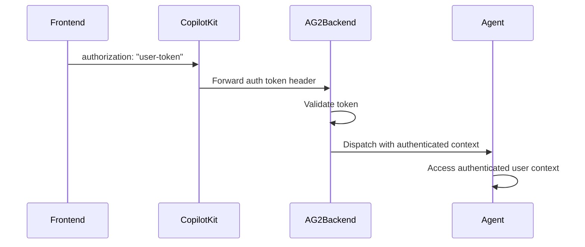

## 概览

CopilotKit 支持两种部署模式下的 AG2 后端用户身份验证：

- **LangGraph Platform 等价模式**：云托管运行时，转发到你的 AG2 `/chat` 端点
- **自托管运行时**：你自己的 CopilotKit 运行时，转发到你的 AG2 `/chat` 端点

两种方式都能让你的 AG2 后端访问已认证的用户上下文并执行授权。

这种模式让你的后端能够：

- 在分发智能体之前校验用户令牌
- 将已认证的用户上下文附加到智能体状态/工具上
- 在服务端执行授权决策

<Callout type="info">
  CopilotKit 消费由 AG2 通过 <code>/chat</code> 流式传输的 AG-UI 协议事件。参见 <a href="https://docs.ag2.ai/docs/user-guide/ag-ui/" target="_blank">AG2 AG-UI 集成文档</a>。
</Callout>

## 工作原理



## 前端配置

通过 `properties` prop 传递你的身份验证令牌：

```tsx
<CopilotKit
  runtimeUrl="/api/copilotkit"
  properties={{
    authorization: userToken, // forwarded to AG2 /chat
  }}
>
  <YourApp />
</CopilotKit>
```

**注意**：`authorization` 属性会作为请求头转发到你的 AG2 `/chat` 端点。

## LangGraph Platform 部署

**对于云托管部署**，请使用令牌请求头校验来保护你的 AG2 `/chat` 端点。

### 配置身份验证处理器

```python
from fastapi import FastAPI, Header, HTTPException
from fastapi.responses import StreamingResponse

from ag2 import Agent
from ag2.ag_ui import AGUIStream, RunAgentInput
from ag2.config import OpenAIResponsesConfig

agent = Agent(
    name="assistant",
    prompt="You are a helpful assistant.",
    config=OpenAIResponsesConfig(model="gpt-5.5"),
)

stream = AGUIStream(agent)
app = FastAPI()

def validate_your_token(token: str) -> dict:
    # Replace this with your own validation logic.
    if token != "valid-token":
        raise HTTPException(status_code=401, detail="Unauthorized")
    return {
        "user_id": "user_123",
        "role": "member",
        # The scope `get_account_data` below checks against.
        "allowed_accounts": ["acct_456"],
    }

@app.post("/chat")
async def run_agent(
    message: RunAgentInput,
    accept: str | None = Header(None),
    authorization: str | None = Header(None),
) -> StreamingResponse:
    if not authorization:
        raise HTTPException(status_code=401, detail="Missing authorization header")

    token = authorization.replace("Bearer ", "")
    user_info = validate_your_token(token)

    # Pass the authenticated user into the run as a dependency, so tools
    # can scope data access to this user. Dependencies stay server-side —
    # unlike variables, they are never streamed to the client as state.
    return StreamingResponse(
        stream.dispatch(message, dependencies={"auth_user": user_info}, accept=accept),
        media_type=accept or "text/event-stream",
    )
```

### 在智能体中访问用户

使用已校验的用户身份来限定工具调用与数据访问的范围：

```python
from typing import Annotated

from ag2 import Inject, tool

@tool
def get_account_data(
    account_id: str,
    auth_user: Annotated[dict, Inject("auth_user")],
) -> dict:
    """Return account data for the authenticated user."""
    if not auth_user:
        return {"error": "unauthorized"}
    # Example check: ensure user can access this account
    if account_id not in auth_user.get("allowed_accounts", []):
        return {"error": "forbidden"}
    return {"account_id": account_id, "owner": auth_user["user_id"]}
```

`Inject("auth_user")` 注解会提取你传递给 `stream.dispatch(...)` 的依赖项——它对 LLM 不可见，也永远不会离开服务器。将该工具注册到智能体上，以便 LLM 能够调用它：

```python
agent = Agent(
    name="assistant",
    prompt="You are a helpful assistant.",
    config=OpenAIResponsesConfig(model="gpt-5.5"),
    tools=[get_account_data], # [!code highlight]
)
```

## 自托管部署

**对于自托管部署**，请在你自己的 FastAPI 服务中使用相同的 `/chat` 请求头校验模式。

### 配置动态智能体

```python
from fastapi import FastAPI, Header, HTTPException
from fastapi.responses import StreamingResponse

from ag2 import Agent
from ag2.ag_ui import AGUIStream, RunAgentInput
from ag2.config import OpenAIResponsesConfig

agent = Agent(
    name="assistant",
    prompt="You are a helpful assistant.",
    config=OpenAIResponsesConfig(model="gpt-5.5"),
    tools=[get_account_data], # [!code highlight]
)

stream = AGUIStream(agent)
app = FastAPI()

@app.post("/chat")
async def run_agent(
    message: RunAgentInput,
    accept: str | None = Header(None),
    authorization: str | None = Header(None),
) -> StreamingResponse:
    if not authorization:
        raise HTTPException(status_code=401, detail="Unauthorized")

    token = authorization.replace("Bearer ", "")
    user_info = validate_your_token(token)  # the same helper as above

    return StreamingResponse(
        stream.dispatch(message, dependencies={"auth_user": user_info}, accept=accept),
        media_type=accept or "text/event-stream",
    )
```

### 在智能体中访问用户

该身份以请求作用域的依赖项形式传递，因此上文展示的 `Inject("auth_user")` 工具在此无需任何改动即可工作——工具本身完全不需要知道部署是托管式还是自托管式。

## 通用身份验证模式

对于同时在云托管和自托管模式下运行的后端，请使用以下模式：

```python
def extract_user_from_auth_header(authorization: str | None) -> dict | None:
    if not authorization:
        return None
    token = authorization.replace("Bearer ", "")
    return validate_your_token(token)
```

然后：

- 在 `/chat` 上读取 `authorization`
- 在 `stream.dispatch(...)` 之前校验令牌
- 将用户作为依赖项附加（`dependencies={"auth_user": ...}`），用于工具授权
- 拒绝未授权或越权的访问
- 如果你暴露了 capabilities `GET` 路由（`stream.capabilities()`），也对其应用相同的校验，以免向匿名调用者描述你的智能体

## 安全注意事项

### LangGraph Platform

- **令牌校验**：在你的 AG2 `/chat` 端点上校验令牌
- **用户范围限定**：按已认证的用户身份限定数据访问范围

### 自托管

- **手动校验**：自行实现并维护校验逻辑
- **请求头转发**：确保你的运行时将 `authorization` 转发给 AG2

### 通用最佳实践

- **权限检查**：在 AG2 工具中执行基于角色的检查
- **传输安全**：通过 HTTPS 提供 `/chat` 服务
- **最小权限**：只返回当前用户/任务所需的数据

## 故障排查

### 常见问题

**令牌未到达后端**：

- 确保你在 `properties` 中传入了 `authorization`
- 确认你的运行时将请求头转发到了 AG2 `/chat`

**令牌格式无效**：

- 以一致的方式同时处理原始令牌和 `Bearer <token>` 两种格式

**意外的匿名访问**：

- 确认 `authorization` 校验发生在调用 `stream.dispatch(...)` 之前

## 后续步骤

- [使用 AG2 后端配置聊天 UI ->](/ag2/prebuilt-components)
- [了解共享状态 ->](/ag2/shared-state)
- [实现人机协同（human-in-the-loop）工作流 ->](/ag2/human-in-the-loop)
